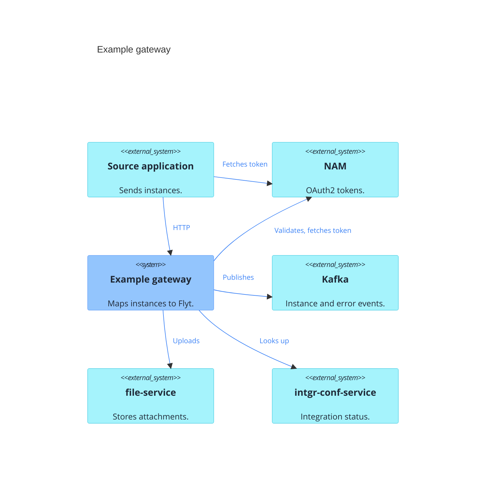
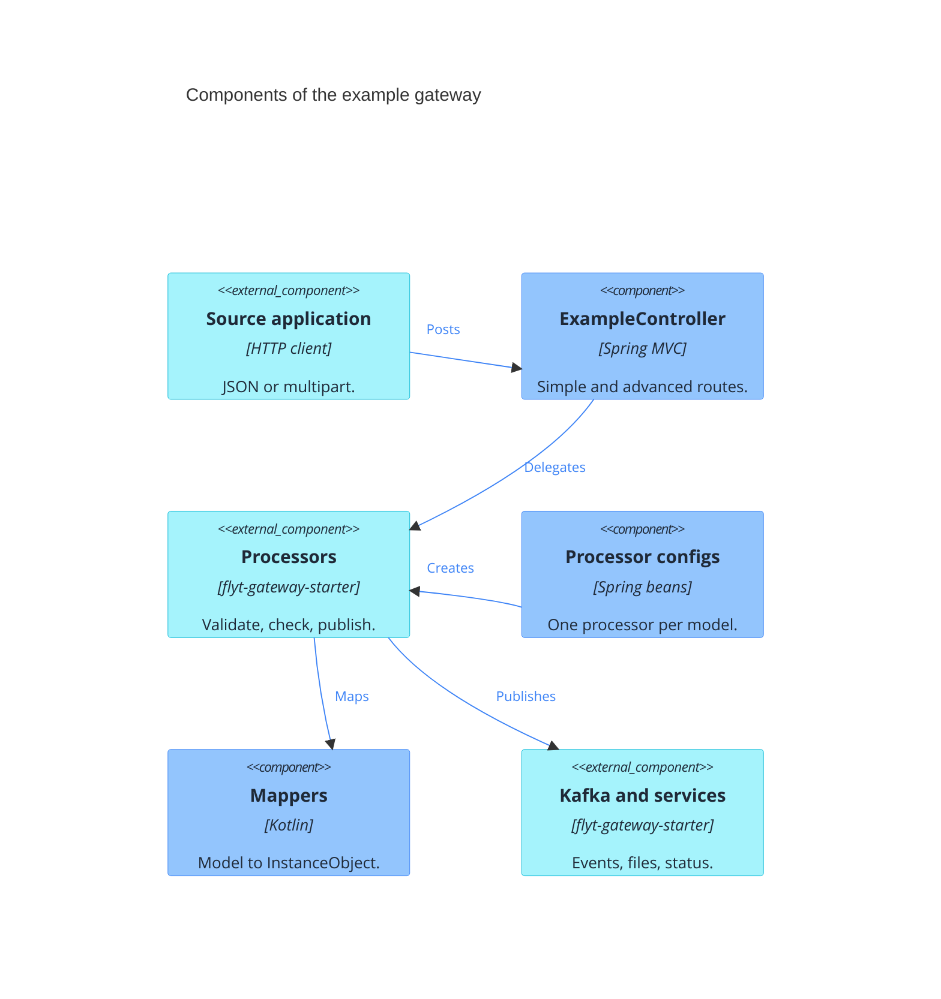

# Architecture

The template is a FLYT gateway built on [flyt-gateway-starter](https://github.com/FINTLabs/fint-flyt-gateway-starter),
which does the processing; see its [architecture](https://github.com/FINTLabs/fint-flyt-gateway-starter/blob/main/docs/architecture.md).
The template adds the controller, processor configuration and mappers for one source application. Blue is the gateway's
own code, turquoise is the starter and other services.

## C4 level 1: System context

flyt-security-starter accepts a source application token only on the routes in `novari.flyt.security.external.paths`
and only from the client ID of the configured `SourceApplication`. The template leaves both unset, so its routes are
denied until a gateway sets them. Internal calls use NAM client credentials.

## C4 level 3: Components

- **ExampleController:** `/api/example/instances/simple` takes JSON; `/api/example/instances/advanced` takes JSON with
  Base64 files or multipart with an `instance` part and file parts.
- **Processor configs:** `SimpleProcessorConfiguration` and `AdvancedProcessorConfiguration` create the processors with
  `InstanceProcessorFactoryService`, a fixed integration ID and the instance ID from the payload.
- **Mappers:** `SimpleMappingService`, `AdvancedMappingService` and `AdvancedMultipartMappingService` map the models to
  `InstanceObject` and store attachments through the `persistFile` callback.
